# Blind ANN Watermark Extractor — Architecture Specification

## 1. Overview & Design Rationale

The **BlindWatermarkExtractor** (`models/blind_extractor.py`) is a compact, domain-informed PyTorch convolutional neural network ($276,466$ trainable parameters) that recovers the **original $32 \times 32$ binary watermark** directly from an attacked $256 \times 256$ normalized $I$-channel **without access to the original clean host image, embedding residual, or crop mask**.

### Input & Output Contract
- **Input Tensor $X$:** Shape `(B, 1, 256, 256)`, `float32` in $[0, 1]$ (attacked watermarked $I$-channel).
- **Output Tensor $\hat{Z}$:** Shape `(B, 1, 32, 32)`, raw logits corresponding to the $32 \times 32$ original binary watermark bits (`predict_proba(X)` applies $\sigma(\hat{Z}) \in [0, 1]$; thresholding at $0.5$ yields binary watermark $\hat{W} \in \{0, 1\}^{32 \times 32}$).

---

## 2. Stage-by-Stage Network Architecture

```mermaid
flowchart LR
    X["Input Attacked I-Channel\n(B, 1, 256, 256)"] --> COND["1. Input Conditioning\nPer-Image Z-Norm + 5x5 High-Pass Residual\n(B, 2, 256, 256)"]
    COND --> STEM["2. Full-Res Stem + ResBlock\n(B, 16, 256, 256)"]
    STEM --> DOWN["3a. Stride-2 Downsample + 2x ResBlock\nMulti-Scale Context (B, 32, 128, 128)"]
    DOWN --> UP["Bilinear Upsample\n(B, 32, 256, 256)"]
    STEM --> FUSE["3b. Multi-Scale Fusion\n1x1 Conv + BN + ReLU + ResBlock\n(B, 16, 256, 256)"]
    UP --> FUSE
    FUSE --> CONF["4a. Tile Confidence Head\n1x1 Conv + Softmax over 64 Tiles\n(B, 1, 32, 32, 64)"]
    FUSE --> FOLD["4b. 8x8 Mosaic Tile Folding\n(B, 16, 32, 32, 64)"]
    CONF --> AGG["4c. Confidence-Weighted + Mean Aggregation\nConcat -> (B, 32, 32, 32)"]
    FOLD --> AGG
    AGG --> DEC["5. 32x32 Residual Decoder\n1x1 Conv(32->64) + 3x ResBlock(64) + 1x1 Head\n(B, 1, 32, 32) Catalan-Domain Logits"]
    DEC --> PERM["6. Exact Keyed Inverse Permutation Buffer\nInverse Catalan + Inverse Arnold\n(B, 1, 32, 32) Original Watermark Logits"]
```

### Layer Details
1. **Parameter-Free Input Conditioning (`BlindWatermarkExtractor.condition`)**
   - Computes per-image mean/std standardization $(X - \mu_X)/(\sigma_X + 10^{-4})$ and a $5 \times 5$ local high-pass residual $50 \cdot (X - \operatorname{AvgPool}_{5\times 5}(X))$.
   - Because the adaptive watermark signal $\alpha(x,y)(W_{\text{mosaic}}(x,y) - 0.5)$ has amplitude $\pm 0.006$ to $\pm 0.018$ while smooth host content spans $[0, 1]$, the high-pass residual immediately suppresses low-frequency host image structure by $> 25\text{ dB}$ without requiring the host image.
2. **Full-Resolution Encoder & Multi-Scale Context Branch**
   - `stem`: `Conv2d(2 -> 16, k=3, pad=1) + BatchNorm2d + ReLU` followed by `full`: `ResBlock(16)`.
   - `down`: Stride-2 `Conv2d(16 -> 32, k=3, s=2, pad=1)` + `ctx`: two `ResBlock(32)` layers at $128 \times 128$ resolution, bilinearly upsampled back to $256 \times 256$.
   - `fuse`: Concatenates full-resolution and context features `(B, 48, 256, 256)` $\to$ `1x1 Conv(48 -> 16) + BN + ReLU + ResBlock(16)`. This estimates local host texture variance (the regime of $\alpha(x,y)$) alongside high-frequency watermark features.
3. **Mosaic-Aware Confidence-Weighted Tile Aggregation**
   - Folds the `(B, 16, 256, 256)` feature tensor into the $8 \times 8$ mosaic grid of $32 \times 32$ tiles: shape `(B, 16, 32, 32, 64)`.
   - A $1 \times 1$ confidence head `conf` predicts a scalar reliability score for every pixel in every tile, normalized via `softmax` across the $64$ tiles. Cropped (zero-filled or noise-filled) tiles automatically receive low weight without needing an external crop mask.
   - Concatenates the confidence-weighted sum and uniform mean across the 64 tiles into `(B, 32, 32, 32)`.
4. **$32 \times 32$ Residual Reconstruction Decoder**
   - Projects `(B, 32, 32, 32)` $\to$ `(B, 64, 32, 32)` via `1x1 Conv + BN + ReLU`, processes through three `ResBlock(64)` modules with spatial $3 \times 3$ context, and projects via `head: Conv2d(64 -> 1, k=1)` to produce $32 \times 32$ logits in the transformed tile domain.
5. **Non-Trainable Keyed Inverse Permutation Buffer (`inv_perm`)**
   - Registers the exact inverse index map $\pi_{\text{key}}^{-1} = (\text{Catalan}_{5, k=7} \circ \text{Arnold}_{10})^{-1}$ as a persistent PyTorch buffer and gathers the $1,024$ logits into their original watermark coordinates.

---

## 3. Weight Initialization & Computational Efficiency

- Kaiming fan-out normal initialization on all convolutions; zero-initialization on the second BatchNorm weight (`b2.weight = 0`) of every `ResBlock` so residual branches start as exact identity mappings.
- **Parameter count:** `276,466` parameters ($\approx 1.1\text{ MB}$ checkpoint).
- **Inference latency:** $\approx 15–35\text{ ms}$ per image on a standard laptop CPU (`torch 2.13.0+cpu`), with automatic CUDA acceleration when a GPU is available.
