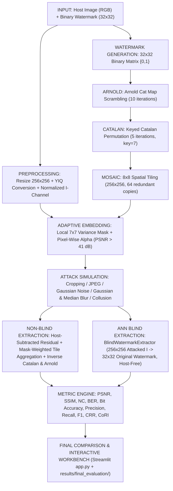
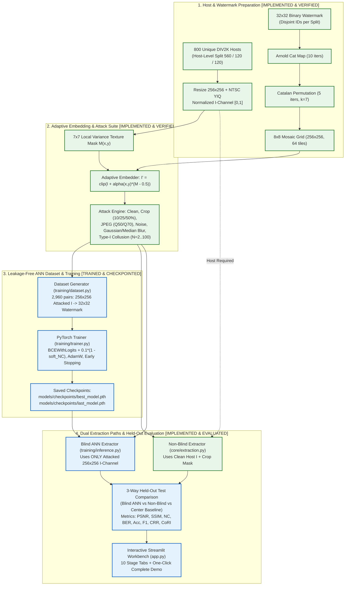

# Hybrid Image Watermarking Pipeline — Implementation Architecture

This document provides complete Mermaid architecture diagrams representing the completed Capstone Robust Image Watermarking system (`PW26_PAC_01`), including both Non-Blind and Blind ANN extraction paths, leakage-free dataset synthesis, model training, evaluation, and the interactive Streamlit workbench.

---

## 1. Complete Final System Architecture

---

## 2. Detailed End-to-End Component, Training & Evaluation Architecture

Status Legend:
- **IMPLEMENTED & VERIFIED**: Core preprocessing, transforms, adaptive embedding, attack engines, non-blind extractor, and test suite.
- **IMPLEMENTED, TRAINED & EVALUATED**: Leakage-free ANN dataset (`data/ann/`), `BlindWatermarkExtractor` (`models/blind_extractor.py`), trained checkpoints (`models/checkpoints/best_model.pth`), blind inference (`training/inference.py`), 3-way evaluation (`results/final_evaluation/`), and interactive Streamlit workbench (`app.py`).

