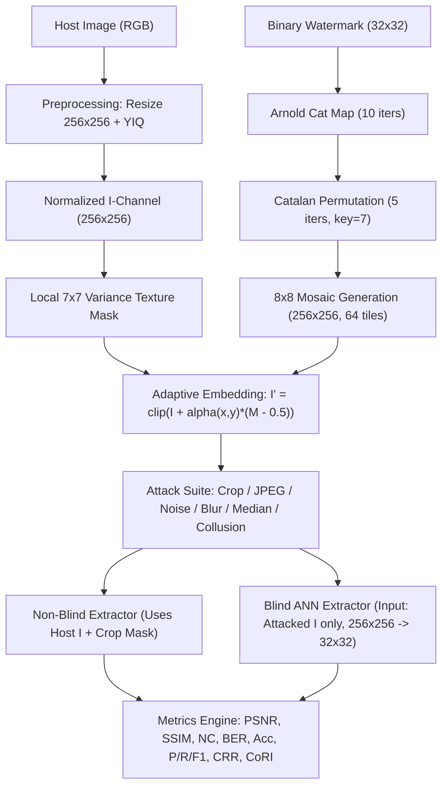

# Technical Audit of the Capstone Watermarking Repository

**Project Title:** Deep Learning-Based Image Watermarking Using Catalan Transform and Mosaic Generation for Enhanced Resistance to Cropping and Collusion Attacks  
**Project ID:** `PW26_PAC_01`  
**Audit Date:** 2026-10-31  

This audit inspects all repository modules, datasets, split files, existing benchmark outputs, and the academic documents (*Capstone Report 1*, *Capstone Report 2*, *Phase 1 ESA Presentation*, *Phase 2 ESA Presentation*, and *Phase 3 ISA-1 Presentation*) prior to finalizing the ANN-based blind extractor and interactive demonstration system.

---

## 1. What Is Already Implemented and Verified

The following components exist in the codebase, execute deterministically, and pass unit/integration validation:

1. **Host Image Preprocessing (`core/preprocessing.py`, `utils/processor.py`, `utils/loader.py`)**
   - Bicubic resizing to $256 \times 256$.
   - RGB/BGR $\leftrightarrow$ YIQ NTSC colour-space transformation (`bgr_to_yiq`, `yiq_to_bgr`).
   - Extraction and min–max normalization of the chrominance $I$-channel to $[0, 1]$ (`float32`), plus physical range metadata (`i_min`, `i_max`) for inverse RGB reconstruction.
2. **Dual Chaotic & Combinatorial Watermark Scrambling (`utils/scrambler.py`, `utils/catalan.py`, `core/watermark.py`)**
   - **Arnold Cat Map (ACM):** 2D discrete torus automorphism $\binom{x'}{y'} = \binom{1\ 1}{1\ 2}\binom{x}{y} \bmod N$ and its exact analytical inverse $\binom{2\ -1}{-1\ \ 1}\binom{x'}{y'} \bmod N$ on $32 \times 32$ binary watermarks (default 10 iterations).
   - **Catalan Transform Permutation:** Deterministic pixel permutation keyed by `(key, iteration)` using arbitrary-precision Catalan numbers $C_n = \frac{1}{n+1}\binom{2n}{n}$ hashed via 64-bit `blake2b` to prevent modulo-collapse on 1024-element arrays (default 5 iterations, key $= 7$).
   - **Bit-exact reversibility:** Verified across arbitrary $32 \times 32$ binary matrices ($\text{BER} = 0.0, \text{NC} = 1.0$).
3. **Mosaic Spatial Redundancy (`utils/mosaic.py`)**
   - Replicates the $32 \times 32$ Arnold+Catalan transformed watermark across an $8 \times 8$ tile grid to form a $256 \times 256$ spatial mosaic (64 redundant copies).
4. **Perceptual Luminance-Texture Adaptive Embedding (`utils/adaptive_embedder.py`, `core/embedding.py`)**
   - Computes local variance $\sigma^2_{\text{local}}(x,y) = E[I^2] - (E[I])^2$ over a $7 \times 7$ box window, normalizes standard deviation to $M(x,y) \in [0, 1]$, and modulates pixel-wise strength:
     $$\alpha(x,y) = \alpha_{\text{base}}\bigl(1 + \gamma \, M(x,y)\bigr), \qquad I'(x,y) = \operatorname{clip}\bigl(I(x,y) + \alpha(x,y)(W_{\text{mosaic}}(x,y) - 0.5),\ 0,\ 1\bigr)$$
   - Default $\alpha_{\text{base}} = 0.012, \gamma = 2.0$ yields mean clean $\text{PSNR} = 41.57\text{ dB}$ and $\text{SSIM} = 0.9965$ across the DIV2K test split.
5. **Conventional Center-Tile Baseline (`utils/baseline.py`)**
   - Embeds a single $32 \times 32$ watermark at center coordinates $[112:144, 112:144]$ with $\alpha = 0.08$ ($\text{PSNR} = 46.02\text{ dB}$).
6. **Attack Simulation Suite (`attacks/cropping.py`, `attacks/signal.py`, `attacks/collusion.py`, `core/attacks.py`)**
   - Cropping (`center`, `random`, `quadrant` at $10\%, 25\%, 50\%$ area removal; zero or noise fill) + exact binary keep-mask generation.
   - Signal attacks: JPEG compression ($Q \in [40, 95]$), additive white Gaussian noise ($\sigma$), Gaussian blur ($k \times k$), and median filtering ($k \times k$).
   - Type-I averaging collusion across $N$ watermarked copies plus collaborative noise $\sigma_c$.
7. **Non-Blind (Host-Subtracted) Extractor & Baseline Benchmark (`core/extraction.py`, `benchmark.py`)**
   - Computes $(I_{\text{attacked}} - I_{\text{host}}) / \alpha_{\text{base}} + 0.5$, folds into $64 \times 32 \times 32$ tiles, performs mask-weighted or uniform tile averaging, thresholds at $0.5$, and runs inverse Catalan followed by inverse Arnold Cat Map.
   - Validated benchmark results stored in `results/phase6_benchmark/` and visual plots in ` reporting/visualizer.py`.

---

## 2. What Is Partially Implemented

1. **CLI Phase Orchestration (`run.py`, `pipeline/phase_runner.py`)**
   - Phases 0–7 execute real code, but Phase 8 (`ann-data`) generates an inconsistent $256 \times 256$ residual target on only a flat list of files without split separation, and Phase 9 (`ann-train`, `ann-eval`) only writes a status JSON (`PLANNED / NOT IMPLEMENTED`).
2. **Collusion Runner in `core/attacks.py` (`AttackRunner.run_collusion`)**
   - When `independent_watermarked_list` is not passed (e.g., in Phase 4 CLI and Demo), lines 120–124 synthesize colluders by adding random Gaussian noise $\mathcal{N}(0, 0.012)$ around `victim_watermarked` rather than embedding $N-1$ independent watermarks into the host. (Note: `benchmark.py` lines 263–276 *did* properly embed independent random watermarks, explaining why Report 2's earlier prototype showed $\text{NC} > 0.90$ at $N=100$ under same-watermark + noise averaging, whereas the corrected `benchmark.py` in the repo honestly shows $\text{NC} \approx 1/\sqrt{N}$ dilution).
3. **Non-Blind Extractor $\alpha$ Compensation (`core/extraction.py`, `benchmark.py`)**
   - Embedding multiplies $(W_{\text{mosaic}} - 0.5)$ by spatially varying $\alpha(x,y) = \alpha_{\text{base}}(1 + \gamma M(x,y)) \in [\alpha_{\text{base}}, 3\alpha_{\text{base}}]$, but extraction divides by scalar $\alpha_{\text{base}}$ uniformly.

---

## 3. What Is Missing

1. **Real Trainable Blind ANN Watermark Extractor (`models/blind_extractor.py`)**
   - `core/ann_interface.py` is strictly an abstract base class and `PlannedANNModelPlaceholder` that raises `NotImplementedError`.
2. **Complete PyTorch Training, Validation, Checkpointing, Inference & Evaluation Stack (`training/*`)**
   - No `Dataset`, `DataLoader`, loss functions, optimizer/scheduler loop, early stopping, checkpoint saving/loading (`models/checkpoints/best_model.pth`, `last_model.pth`), or host-free blind inference module existed prior to this completion work.
3. **Three-Way Held-Out Evaluation (`results/final_evaluation/`)**
   - No comparison of Proposed Hybrid + Blind ANN vs. Proposed Hybrid + Non-Blind vs. Conventional Center-Tile Baseline on held-out test hosts, nor formal implementations of **Cropping Resistance Ratio (CRR)** and **Collusion Robustness Index (CoRI)**.
4. **Interactive Stage-Wise Demonstration Application (`app.py`)**
   - No Streamlit application existed to inspect and run all 10 pipeline tabs interactively or execute a single-click full pipeline demonstration switching between Blind ANN and Non-Blind extraction.

---

## 4. Technical Inconsistencies & Bugs Identified

### 4.1 Dataset Label Mismatch ($256 \times 256$ Residual vs. $32 \times 32$ Original Watermark)
- `core/ann_interface.py` specifies `input_shape: [1, 256, 256]` and `output_shape: [1, 32, 32]`.
- However, `create_training_data.py` (line 48) and `pipeline/phase_runner.py` (line 718) save labels of shape $(256, 256)$ equal to `np.clip((watermarked - host) / alpha_base + 0.5, 0, 1)`.
- Furthermore, `create_training_data.py` uses `alpha_base = 0.03` (default in `AdaptiveEmbedder.__init__` is `0.05`, while `config/default.yaml` uses `0.012`), creating a mismatch in embedding amplitude.

### 4.2 Severe Train / Validation / Test Host Leakage in `splits/*.txt`
- `preprocessed/I_channel/` contains $1,100$ `.npy` files named `<4-digit-host-id>_<5-digit-counter>.npy` (e.g., `0002_00001.npy` and `0002_00002.npy`).
- Direct inspection proves that files sharing the same 4-digit prefix come from the **exact same DIV2K source image** (`np.abs(a - b).mean() == 0.0`), and there are **800 unique DIV2K hosts** across the $1,100$ files.
- The legacy `splits/train.txt` (770 files), `splits/val.txt` (165 files), and `splits/test.txt` (165 files) were split across the $1,100$ file names rather than the 800 unique host IDs:
  - **Train $\cap$ Test host overlap:** **59 identical host images**
  - **Train $\cap$ Val host overlap:** **53 identical host images**
  - **Val $\cap$ Test host overlap:** **19 identical host images**
- **Single-Watermark Memorization Trap:** In `create_training_data.py` and `phase_runner.py` Phase 8, every training pair embeds the **same single watermark** (`watermark_binary.npy`). If a neural network is trained on a dataset where all labels $Y$ are identical (`PW26_PAC_01`), the network trivially zeroes its convolutional weights and learns a constant bias equal to `PW26_PAC_01`, achieving $100\%$ accuracy even on noise or unwatermarked images!

### 4.3 Non-Blind $\alpha(x,y)$ vs. $\alpha_{\text{base}}$ Approximation
- Because $(W_{\text{mosaic}} - 0.5) \in \{-0.5, +0.5\}$ has sign independent of $\alpha(x,y) > 0$, dividing by $\alpha_{\text{base}}$ scales each tile sample by $1 + \gamma M(x,y) \in [1, 3]$. Under clean conditions, positive and negative offsets remain strictly separated around $0.5$. Under additive attack noise $\eta(x,y)$, however, uniform averaging weights textured pixels (where embedded signal is $3\times$ stronger) equally with smooth pixels in the raw difference, or equivalently $3\times$ higher in normalized units, whereas minimum-variance unbiased estimation (matched filtering) or inverse-$\alpha$ normalization has distinct trade-offs. We explicitly evaluate both `nonblind_base` (legacy) and `nonblind_pixel` (exact inverse-$\alpha(x,y)$ compensation).

### 4.4Terminology Clarifications Relative to Phase 1 / Phase 2 Reports
- **Arnold Cat Map & Catalan Transform:** In `utils/scrambler.py` and `utils/catalan.py`, both transforms are **deterministic keyed spatial permutations** (bijections of the $1,024$ pixel coordinates of a $32 \times 32$ array). They provide key-dependent spatial decorrelation and scrambling, *not* modern cryptographic encryption or higher-dimensional feature embeddings.
- **Collusion:** Under a scientifically valid Type-I averaging collusion model where $N$ copies of the same host carry $N$ *independent* watermarks (1 victim + $N-1$ other fingerprints), the victim watermark signal is attenuated by $1/N$ while $N-1$ independent watermark signals of equal power interfere with it. Consequently, the theoretical upper bound on expected correlation with any single colluder's watermark is $1/\sqrt{N}$, which degrades rapidly as $N$ grows ($N \ge 5$).

---

## 5. What Must Be Changed to Achieve a Working Blind ANN Extractor

1. **Diverse Watermarks During Training + Key-Aware Permutation Inversion:**
   - To force the ANN to genuinely extract the embedded watermark signal from the image rather than memorizing a single logo, training samples must embed **thousands of distinct random binary watermarks** (with disjoint watermark ID ranges across train, val, and test splits).
   - Because the forward pipeline applies the keyed bijection $\pi_{\text{key}} = \text{Catalan} \circ \text{Arnold}$ before tiling into an $8 \times 8$ mosaic, any $32 \times 32$ tile in the $256 \times 256$ image contains $\pi_{\text{key}}(W)$ modulated by local host texture.
   - Our `BlindWatermarkExtractor` (`models/blind_extractor.py`) therefore:
     1. Suppresses low-frequency host content via parameter-free local conditioning (per-image standardization + $5 \times 5$ high-pass residual channel).
     2. Extracts full-resolution residual features and multi-scale ($128 \times 128$) host-texture context via residual CNN blocks to implicitly estimate local $\alpha(x,y)$ scaling and attack corruption.
     3. Folds the $256 \times 256$ feature map into the $8 \times 8$ grid of $32 \times 32$ tiles and applies a **learned confidence-weighted softmax aggregation** alongside mean pooling across the 64 tiles (so cropped or saturated tiles receive near-zero weight without needing an external crop mask).
     4. Decodes the aggregated $32 \times 32$ representation via residual blocks to predict logits in the permuted tile domain.
     5. Applies the exact, non-trainable inverse permutation buffer $\pi_{\text{key}}^{-1}$ (`inv_perm`) to output logits of the **original $32 \times 32$ watermark** directly (`shape: (B, 1, 32, 32)`).
2. **Negative-Control Verification:**
   - Evaluate the trained blind ANN on unwatermarked hosts and against unrelated watermarks to prove $\text{NC} \approx 0$ (no watermark hallucination or memorization).

---

## 6. What Must Be Changed in the Dataset-Generation Methodology

1. **Strict Host-Level Split (`splits/host_level/`):**
   - De-duplicate the $1,100$ preprocessed files into the **800 unique DIV2K host IDs** (`0001`–`0800`) and partition them deterministically (`seed=42`, $70\% / 15\% / 15\%$) into **560 train hosts, 120 validation hosts, and 120 test hosts** with **zero host overlap** (`train ∩ val = 0`, `train ∩ test = 0`, `val ∩ test = 0`).
2. **Disjoint Watermark IDs:**
   - Train watermarks: IDs $[10000, 50000)$; Validation watermarks: IDs $[50000, 60000)$; Test watermarks: IDs $[60000, 70000)$ plus canonical ID `0` (`PW26_PAC_01`, restricted to test/demo only).
3. **Direct Supervised Target:**
   - Input $X \in \mathbb{R}^{256 \times 256}$: attacked watermarked normalized $I$-channel.
   - Label $Y \in \{0, 1\}^{32 \times 32}$: original $32 \times 32$ binary watermark prior to Arnold/Catalan transformation.
4. **Broad Attack Distribution:**
   - Clean, random cropping ($5\%–55\%$), center cropping ($10\%, 25\%, 50\%$), JPEG ($Q \in [45, 95]$), Gaussian noise ($\sigma \in [0.005, 0.06]$), Gaussian blur ($k=3$), median blur ($k=3$), and combined crop + signal attacks.

---

## 7. Final End-to-End Research Architecture

